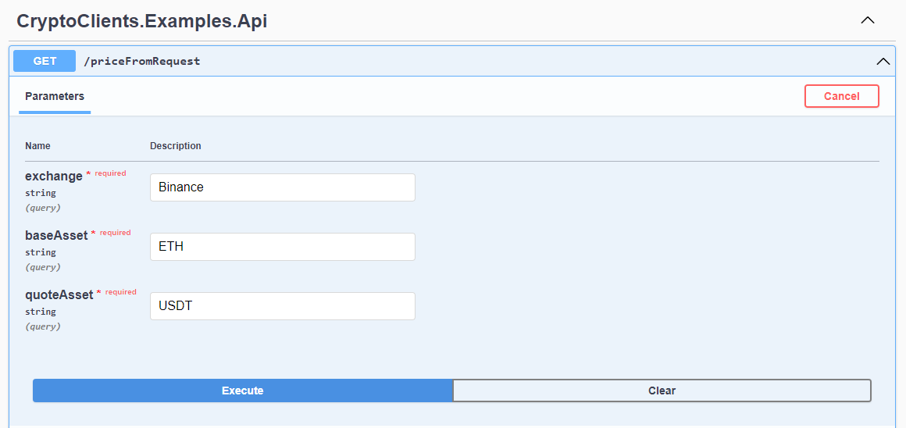
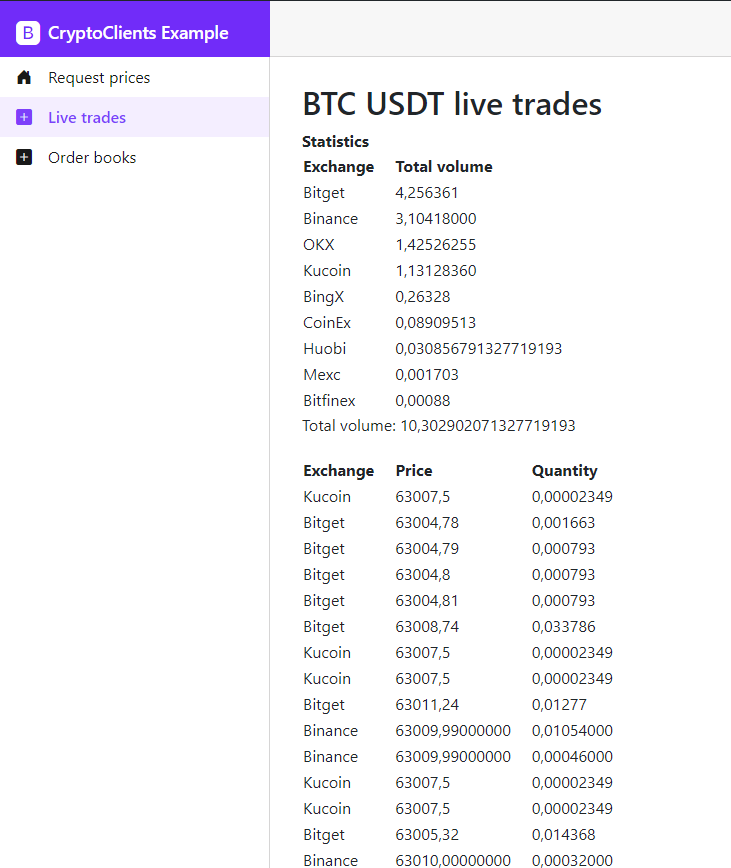
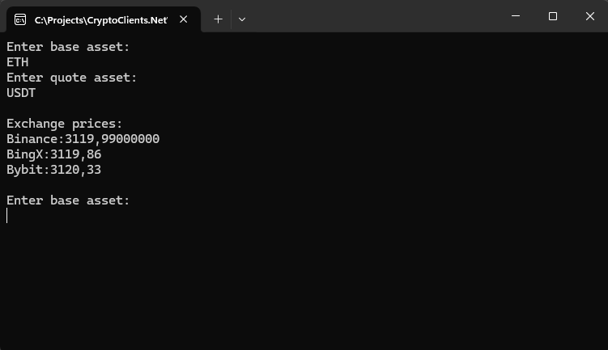
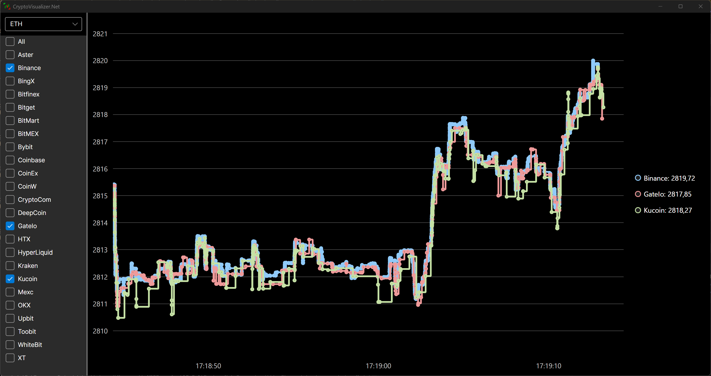

## CryptoClients.Net examples

### CryptoClients.Examples.Api
An example of how to use CryptoClients.Net in a web API

### CryptoClients.Examples.Blazor
An example of how to use CryptoClients.Net in a Blazor server application

### CryptoClients.Examples.Console
A basic console application showcasing how CryptoClients.Net can be used

### CryptoVisualizer.Net
Chart visualization of live trades on all exchanges using Avalonia  
(Set CryptoVisualizer.Net.Desktop as startup project)

## Focused examples and validation

- [Standalone programs](ai-friendly/README.md): V2 fan-out, native access, subscriptions, factories, and account reads.
- [Request current prices](RequestCurrentPrices/RequestCurrentPrices.csproj).
- [Request spot symbols](RequestSpotSymbols/RequestSpotSymbols.csproj).
- [Stream symbol prices](StreamSymbolPrices/StreamSymbolPrices.csproj).
- [Stream trades](StreamTrades/StreamTrades.csproj).
- [Console project](CryptoClients.Examples.Console/CryptoClients.Examples.Console.csproj).
- [API project](CryptoClients.Examples.Api/CryptoClients.Examples.Api.csproj).
- [Blazor server project](CryptoClients.Examples.Blazor/CryptoClients.Examples.Blazor.csproj).

Build individual projects with `dotnet build <project.csproj> -p:BuildAllFrameworks=true`; builds do not execute exchange requests. The full solution also contains CryptoVisualizer platform projects requiring mobile/browser workloads. Running examples can open live streams or make authenticated requests.

See the [consumer skill](../.claude/skills/cryptoclients-net/SKILL.md) and [repository instructions](../AGENTS.md).
